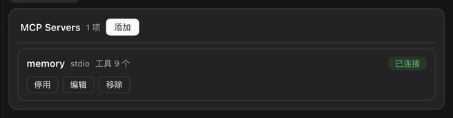
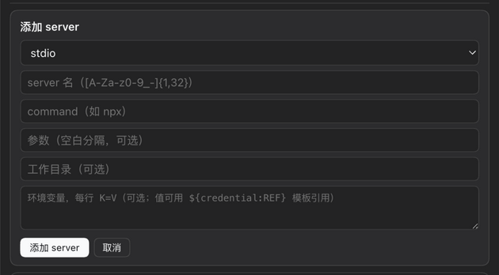

# @hankchen/dsh-mcp

dsh（DeepSeek Harness）的 MCP server 对话内管理插件：装进 profile（`~/.dsh/profiles/<名>/` 下的宿主配置单元）即可在对话里列出、添加、启停、移除 MCP server（接入会话的 Model Context Protocol 服务），全程不手写配置文件。

## 要求

- dsh ≥ `0.2.2-rc.2`：包声明 `engines.dsh`，装进更老版本的宿主会被版本校验拒绝。
- 安装过程需要访问 npm registry；内网/代理环境见下方「网络要求」。

## 安装

方式一（推荐）：套件初始化器勾选安装——

```bash
npx @hankchen/infra
```

选「插件」类型、勾选 `@hankchen/dsh-mcp`、选定目标 dsh profile；安装器转发官方安装命令，完成后自动核对两处安装落点。

方式二：官方命令直装——

```bash
dsh plugin --profile <名> add @hankchen/dsh-mcp
# dsh 不在 PATH 时经官方 npm 包转发同一条命令：
npx @deepseek-ai/dsh plugin --profile <名> add @hankchen/dsh-mcp
```

## 启用

装进 profile 即启用，无额外开关。宿主加载本插件后，三个使用入口（/mcp 命令、mcp_manage 工具、右栏面板）同时可用。

## 使用方法

同一个管理能力有三个入口，任选其一；改动立即生效且持久保存（重启宿主后仍在）。

### 入口一：会话里输入 /mcp 命令

| 子命令 | 作用 |
|---|---|
| `/mcp list` | 列出全部 MCP server 与连接状态 |
| `/mcp add stdio <名> <命令> [参数…] [--cwd=<目录>] [--env=<键=值>]…` | 添加本地命令型 server |
| `/mcp add remote <名> <URL> [--header=<键=值>]…` | 添加远程端点型 server |
| `/mcp remove <名>` | 移除 server |
| `/mcp enable <名>` / `/mcp disable <名>` | 启用 / 停用（停用保留配置，断开连接） |

示例（可复制）：

```bash
/mcp add stdio fetch npx -y mcp-server-fetch
/mcp add stdio github npx -y @modelcontextprotocol/server-github --env=GITHUB_TOKEN=${credential:githubToken}
/mcp add remote docs https://mcp.example.com/mcp --header=Authorization=${credential:docsToken}
/mcp disable fetch
```

两条边界：

- server 名只允许字母、数字、`_`、`-`，1–32 个字符。
- 命令选项值按空白切分、不做引号剥离：值里不能有空格，含引号的值会在添加时被拒收。含空格/引号的复杂值请用右栏面板或 `mcp_manage` 工具。

### 入口二：直接用自然语言说

对话里直接提需求即可，助手会调用本插件注册的 `mcp_manage` 工具完成同样操作：

> 帮我接入 filesystem server：命令 npx，参数 -y @modelcontextprotocol/server-filesystem /tmp

这个入口支持全部配置字段——除命令所及的传输类型、环境变量、请求头外，还包括命令入口没有的单次调用/启动/关闭超时与重连策略；也适合传含空格或引号的复杂值。

### 入口三：客户端右栏「MCP Servers」面板

打开 dsh 客户端右栏（侧边栏右侧）的「MCP Servers」页：

- 点面板头部「添加」展开表单：选传输类型（stdio / streamable-http），填名称与对应字段，提交。
- 每行 server 卡片上有状态徽章与操作按钮：
  - 「启用 / 停用」「编辑」「移除」三个常驻按钮；
  - 状态为「失败」的行多一个「重试」，状态为「已停用」的行多一个「探测」（探测只验证连通性，不改变条目）。
- 「编辑」里传输类型不可改——换类型请移除后重新添加；环境变量 / 请求头每行一条 `键=值`，未改动的行（含凭据模板串）保存时原样保留。

面板总览——每个 server 一张行卡，右侧状态徽章（下例「已连接」含可用工具数），行内操作按钮：



点头部「添加」在清单上方展开表单，选传输类型（stdio / streamable-http）后填对应字段提交：



### 状态徽章含义

| 徽章 | 含义 |
|---|---|
| 已连接 | 正常，标注可用工具数 |
| 连接中 / 重连中 | 连接进行中（重连中带失败原因与重试进度） |
| 等待凭据 | `${credential:…}` 引用的凭据缺失，带缺失详情 |
| 失败 | 连接失败（加载/清理等），带失败原因，可「重试」 |
| 已停用 | 配置保留、连接已断开，可「探测」或重新启用 |
| 已关闭 | 连接已正常关闭 |

## 凭据：用 `${credential:REF}` 模板，不用明文

server 条目的 `env` / `headers` / `command` / `args` / `cwd` / `url` 的值都支持 `${credential:REF}` 模板串引用凭据。添加 server 时优先用模板而非明文：模板串原样进配置，凭据展开与日志脱敏由官方运行时承担，密钥不落配置文件；明文密钥会直接写进 profile 配置，能免则免。

## 常见问题

- **装完右栏没有「MCP Servers」页，或 `/mcp` 不被识别**：重启客户端 app，或在插件管理器里把本插件关一次再开。面板资源随页面加载注入，装完当下的页面不会自动补载。
- **移除后列表里还留着一条「非配置条目」**：条目配置已删、后台清理未完成，重启宿主后消失，无需处理。
- **想装进 desktop profile**：套件初始化器目前拒绝安装 desktop（保留名单内），可经官方命令直装：`dsh plugin --profile desktop add @hankchen/dsh-mcp`。
- **`/mcp` 报「mcp-manager 提供者未在场或未激活」**：属宿主组合故障，排查步骤见 [MAINTAINER.md](./MAINTAINER.md)。

## 网络要求

安装链路需要访问 npm registry。内网、公司代理环境先配镜像或代理再安装：

```bash
# 走公共镜像源
npm config set registry https://registry.npmmirror.com
# 或走 HTTP 代理
npm config set proxy http://127.0.0.1:7890
npm config set https-proxy http://127.0.0.1:7890
```

恢复默认：`npm config delete registry`、`npm config delete proxy`、`npm config delete https-proxy`。

---

维护者向内容（实现决策、已知边界、故障排查与恢复配方）见 [MAINTAINER.md](./MAINTAINER.md)，该文件不随 npm 包分发。
