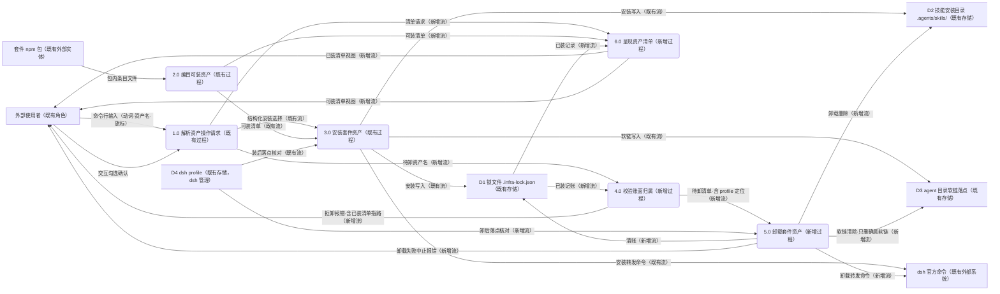
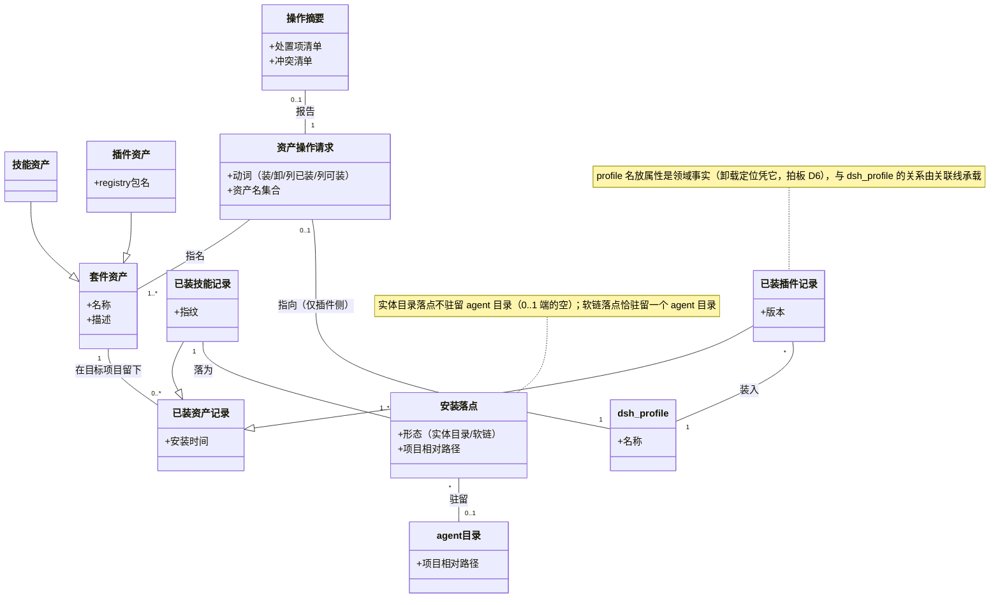
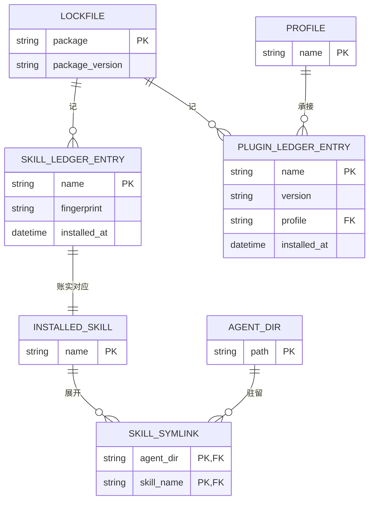

# 命令行剩余动词（卸载与清单）系统分析：账本驱动的资产增删查

## 流程模型

DFD Level 0（Gane-Sarson 方言）：装（既有）与卸（新增）共用同一账本 D1，卸载新增「校验账面归属」前置过程，清单新增「呈现资产清单」过程。无控制流——带名/交互勾选/--all 的分派是进入 1.0 的三种输入数据流，判定本身不入图。

要点：卸载流（1.0→4.0→5.0）与安装流（1.0→3.0）对称——同一批存储（D1/D2/D3/D4）双向写；D4 的落点核对在安装侧核「落点齐备」、卸载侧核「落点消失」。清单流是纯读：已装视图源 D1，可装视图源 2.0 编目。

## 对象模型

概念类图：套件资产按安装机制分两类（copy 类技能 / command 类插件），账本记录随之两分；安装落点统一承载「实体目录 + 软链」两种形态（异常流 2 的「只删确属软链」判别落在形态属性上）。

新术语对齐：「已装资产记录」「安装落点」为本分析引入的领域词（账本条目与落点的统称），与 GLOSSARY 既有词条「锁文件」「套件资产」「agent 插件」衔接，无冲突；spec 若采纳建议同步登记。

## 数据模型

ER（概念+逻辑层）：锁文件 = 文档头 + 两条账行实体；账与落点实体之间是「账实对应」不变式（有账应有实体，卸载即同删）。本次需求**零新增持久化实体**——新增的是对既有存储的删（卸载）与读（清单）。

- 全部实体均标「既有」；PROFILE 归 dsh 管理与初始化，套件只读核对其官方格式两落点（依赖行 + bundles 行）——逻辑引用，非本系统存储。
- SKILL_LEDGER_ENTRY 的 fingerprint 在本轮卸载语义中不参与判别（拍板 D5：记账为准，账上名字即凭据），保持信息性属性；PLUGIN_LEDGER_ENTRY 的 profile 是卸载定位键（拍板 D6）。
- 锁文件骨架保留（need FR-5）对应 LOCKFILE 头实体与账行分离：账行清空不等于头实体删除。

## 缺口与矛盾

走查记录（need 场景节 9 条，逐条三视图结论）：

- 场景 1（带名卸技能）：流程 1.0→4.0（读 D1）→5.0→删 D2/D3、清 D1；对象「资产操作请求→已装技能记录→安装落点」关联承载；数据 SKILL_LEDGER_ENTRY/INSTALLED_SKILL/SKILL_SYMLINK 删行齐——走通。
- 场景 2（账面定位卸插件）：流程 4.0 从 D1 plugins 记账取 profile→5.0 转发 dsh→D4 落点核对→清账；对象「已装插件记录 *--1 dsh_profile」承载定位；数据 profile 属性落点齐——走通。
- 场景 3（无参交互卸载）：1.0 承接交互勾选确认→4.0（勾选源=D1 已装记录，与 add 勾选源=可装清单不同源，动词区分承载）→5.0——走通；plugin 侧交互的 profile 维度形态 need 已标假设 A2 留 spec——带假设通过。
- 场景 4（清单）：6.0 双源呈现（D1 已装 / 2.0 可装）——走通。
- 场景 5（--all 全卸）：4.0 全账为待卸集合→5.0 逐条；空账口径 need 已标假设 A1 留 spec——带假设通过。
- 异常流 1（未记账拒卸）：4.0→「拒卸报错·含已装清单指路」→user——走通。
- 异常流 2（软链位被占）：安装落点.形态=软链承载「确属软链」判别，操作摘要.冲突清单承载「记冲突跳过」——走通。
- 异常流 3（官方命令失败）：起草时 5.0→user 的失败中止报错流缺失，补「卸载失败中止报错（新增流）」后重走——走通。
- 异常流 4（desktop 拒卸）：流程模型找不到「拒卸」前置过程可挂、对象模型无保留 profile 概念、且 need S6 的前提「装入侧 F4 拒 desktop」在代码现状已不成立——走不通，缺口 1。

缺口清单：

- 缺口 1（异常流 4 走查走不通）：need S6/FR-2 拍板「desktop 保留名拒卸、与装入 F4 同口径拒」，但装入侧的 desktop 拒装分支已随 spec 20261119-7a9a（票 20261119-443c）移除——官方 CLI 已放行 desktop 插件管理，`src/kernel/dsh-command.ts` 现码无保留名拒装；need 拍板引用的「同口径」基准已不存在。卡点：三视图无「保留 profile 拒操作」元素可挂。处置：留缺口节，dev-spec 归置——重拍 desktop 卸载口径（对称放行与 add 同态，或双侧恢复拒装），并附注 docs/plugin-assets.md「初始化器仍拒装」表述与代码现状的矛盾（文档债，归 dev-docs 域另案）。

---（方案段由方案形态续写，分析态产物先空缺）---
