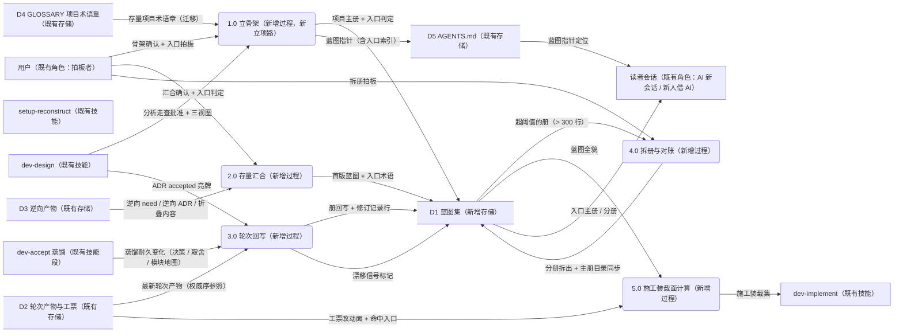
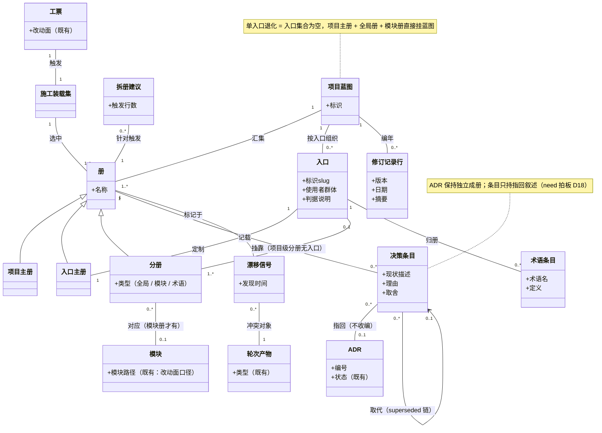
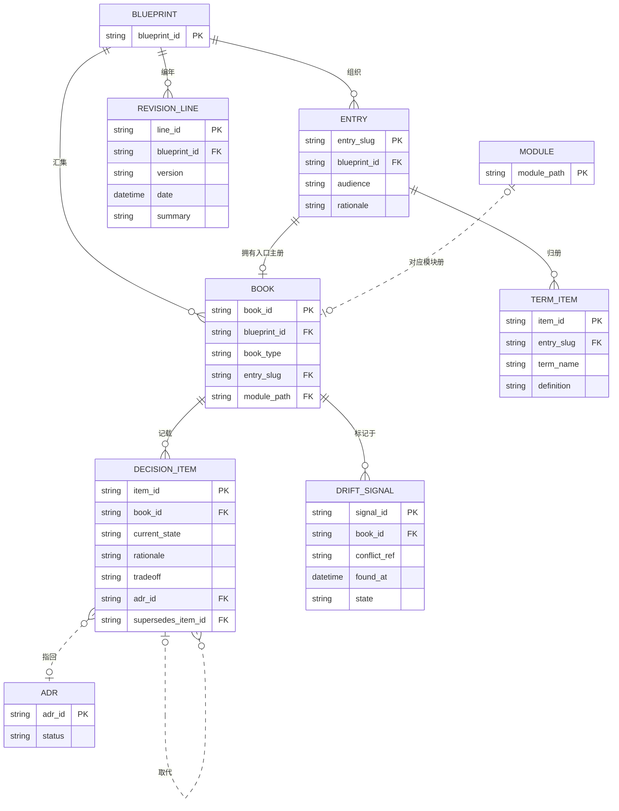

# 项目蓝图：诞生、保鲜与消费的系统分析

> 分析形态产物，输入 = confirmed need [20261124-a727](../needs/20261124-a727-project-blueprint.md)。概念层产物：不写文件路径细节与代码，不做架构决策（方案段的事）。图内「既有」= 套件现状要素，「新增」= 本 need 引入。

## 流程模型

系统边界 = 蓝图能力子系统；执行载体为蓝图维护技能（新增），既有套件技能作外部实体。数据存储：D1 蓝图集（新增存储，docs/blueprints/ 概念位）、D2 轮次产物与工票（既有）、D3 逆向产物（既有，setup-reconstruct 落）、D4 GLOSSARY 项目术语章（既有）、D5 AGENTS.md（既有）。

无控制流：亮牌、拍板、阈值判定不在图上画菱形——它们的输入输出数据流已入图（如"超阈值的册"是一条数据流），判定本身归方案段。

## 对象模型

概念类图（Fowler / Larman 口径：领域词汇，无操作无软件类）。泛化只画真实分类学：「册」是项目主册 / 入口主册 / 分册的父类。

## 数据模型

ER，停概念 + 逻辑层。落盘形态（文件组织 / frontmatter 字段）属物理层，spec 定。实体名用拉丁大写便于渲染，中文对照：BLUEPRINT = 项目蓝图、ENTRY = 入口、BOOK = 册、REVISION_LINE = 修订记录行、DECISION_ITEM = 决策条目、TERM_ITEM = 术语条目、DRIFT_SIGNAL = 漂移信号、ADR 与 MODULE = 既有概念。

TERM_ITEM 约束声明（图旁 note）：同一入口内术语名唯一（UK = entry_slug + term_name），跨入口允许同名不同义——这正是术语按入口归册的需求本意。DRIFT_SIGNAL 的 `state`（待回写 / 已消解）是漂移信号的天然两态，非蓝图状态机（need 拍板 D11 不冲突）。

## 缺口与矛盾

### 走查记录（need 场景节 S1–S4 / E1–E4 × 三视图）

- S1 新立项蓝图诞生：流程模型 dev-design 批准流 → 1.0 → D1/D5 齐、术语迁移流（E3 走查补图后）入 1.0——走通；对象模型 项目蓝图-入口-册-决策条目 承载创建动作——走通；数据模型 BLUEPRINT / ENTRY / BOOK 落点齐——走通。
- S2 施工装载：流程模型 D2 改动面 → 5.0 → D1 → 施工会话可走至装载集产生，但「改动面命中入口」一步无承载——模块与入口的归属关系在数据模型无关联（BOOK 只挂 module 不挂 entry）、流程模型 5.0 的入口命中输入无来源——走不通，缺口 1。
- S3 轮次回写：流程模型 蒸馏流 → 3.0 → D1 回写 + 修订行——走通；对象模型 决策条目-册 关联承载——走通；数据模型 DECISION_ITEM / REVISION_LINE 落点齐——走通。但「折进对应蓝图册」的归册判定规则未定（见缺口 2，流程有承载、规则缺席，留痕）。
- S4 存量汇合：流程模型 D3 / D4 → 2.0 → D1 可走，但存量项目的入口判定输入无来源——逆向产物无入口维度（D3 五路落点不含应用入口），2.0 的入口识别靠什么未定——走不通，缺口 3。
- E1 蓝图过期冲突：流程模型「冲突发现」无过程承载——3.0 是回写不是检测，ADR accepted 亮牌只覆盖 supersede 一类冲突，更广的架构漂移谁来发现未定——走不通，缺口 4。
- E2 超阈值拆册：流程模型 D1 超阈值册 → 4.0 → 拆册拍板 → 分册拆出 + 目录同步——走通；对象模型 拆册建议-册 关联承载——走通；数据模型 BOOK 拆分落点齐——走通。
- E3 蓝图未诞生时新术语：流程模型 澄清期登记走 D4（既有行为，入图作暂存位），迁移在 1.0 / 2.0 承载——补图（1.0 增 D4 迁移流）后重走——走通。
- E4 入口判属争议：流程模型 用户拍板流在 1.0 / 2.0 / 4.0 在图——走通；对象模型 候选列呈属会话交互不建类、亮牌动作由拆册建议同族概念承载——走通；数据模型 ENTRY 识别字段齐——走通。

### 缺口

- 缺口 1（S2 走查走不通）：**模块 ↔ 入口归属无登记载体**——施工装载「改动面命中入口」在数据模型没有 ENTRY–MODULE 关联（模块册只挂模块不挂入口），共享模块（一个模块服务多入口）时命中多套入口主册的装载语义也无从判定。卡：数据模型 + 流程模型 5.0。处置：留缺口节，dev-spec 归置（可能形态：入口主册模块地图节 / 归属登记实体——spec 拍板）。
- 缺口 2（S3 走查留痕）：**蒸馏回写的落册判定规则未定**——耐久变化（决策 / 取舍 / 模块地图变化）折进哪个册：模块册不存在时新建还是进全局册 / 入口主册；跨入口共享决策归项目主册的判定口径未定。卡：流程模型 3.0（过程有承载、规则缺席）。处置：留缺口节，dev-spec 归置。
- 缺口 3（S4 走查走不通）：**存量汇合路的入口识别来源未定**——逆向产物（need / spec / adr / 折叠内容）无应用入口维度，2.0 的入口判定靠扫描识别还是用户点名未定。卡：流程模型 2.0。处置：留缺口节，dev-spec 归置。
- 缺口 4（E1 走查走不通）：**漂移信号的检测者与时机未枚举**——ADR accepted 亮牌只覆盖「决策被取代」一类，架构漂移的其他冲突（模块地图变化、领域概念变化）由谁在何时发现并标记未定（评审轴？验收走查？专门巡检？）。卡：流程模型（缺「冲突发现」过程）。处置：留缺口节，dev-spec 归置。

---（方案段由方案形态续写，分析态产物先空缺）---
